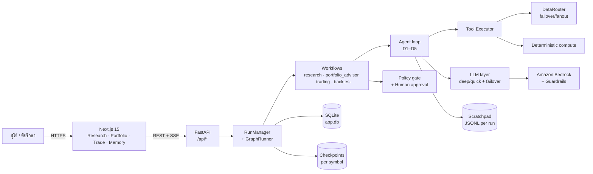
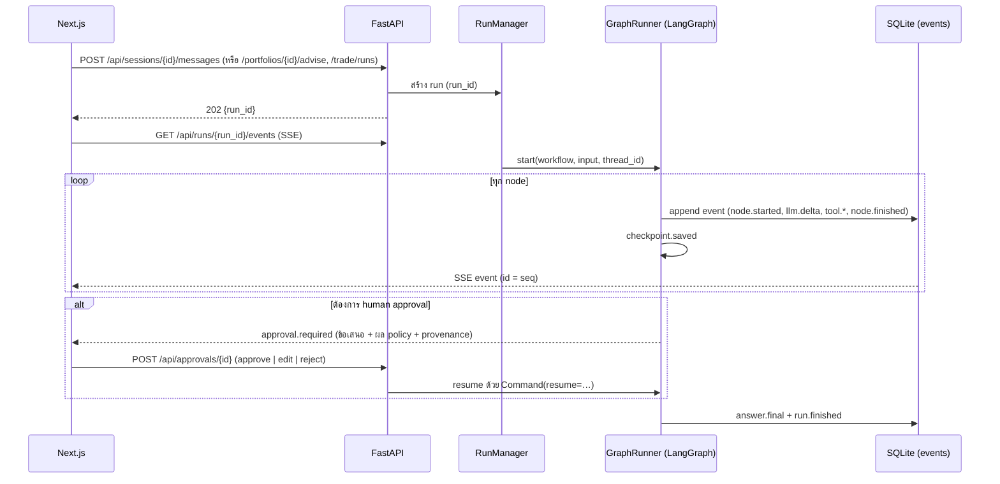
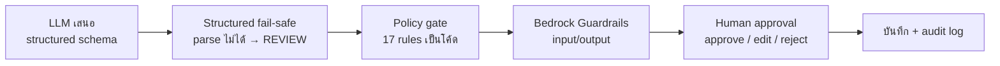
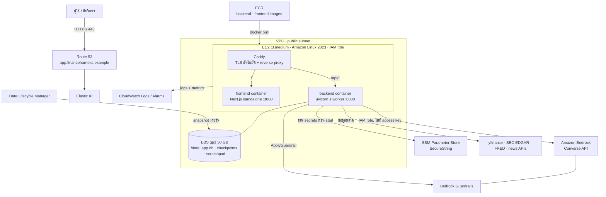
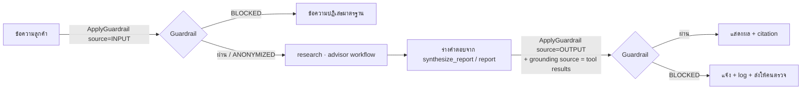

# Finance Harness: Technical Document

> AI Wealth Advisor ทำงานตาม workflow ของที่ปรึกษาการลงทุนมืออาชีพ: รู้จักลูกค้า (risk profiling), เปรียบเทียบผลิตภัณฑ์ (product comparison) และสนทนาให้คำแนะนำ (advisory dialogue) ผลลัพธ์คือคำแนะนำการจัดสรรสินทรัพย์ที่ **ผ่านกฎ (compliant)** และ **อธิบายได้ทุกตัวเลข (explainable)**
>
> Branch: `FinTechathon` · Backend Python 3.12 / FastAPI / LangGraph · Frontend Next.js 15 / React 19

---

## สารบัญ

1. [ภาพรวมสถาปัตยกรรม](#1-ภาพรวมสถาปัตยกรรม)
2. [Tech stack](#2-tech-stack)
3. [โครงสร้างโค้ด](#3-โครงสร้างโค้ด)
4. [Flow หลักของระบบ](#4-flow-หลักของระบบ)
5. [Harness runtime: กลไกที่ทำให้ agent เชื่อถือได้](#5-harness-runtime-กลไกที่ทำให้-agent-เชื่อถือได้)
6. [Compliance & Explainability](#6-compliance--explainability)
7. [Data layer](#7-data-layer)
8. [LLM layer](#8-llm-layer)
9. [API และ Streaming](#9-api-และ-streaming)
10. [Storage](#10-storage)
11. [การ deploy บน AWS: EC2 + Bedrock + Guardrails](#11-การ-deploy-บน-aws-ec2--bedrock--guardrails)
12. [Security](#12-security)
13. [Testing & Quality](#13-testing--quality)
14. [ข้อจำกัดที่รู้อยู่และแผนถัดไป](#14-ข้อจำกัดที่รู้อยู่และแผนถัดไป)

---

## 1. ภาพรวมสถาปัตยกรรม

กฎข้อแรกของระบบคือ **Harness ≠ Domain**

```
┌──────────────────────── HARNESS (app/harness) ────────────────────────┐
│ orchestration · state · checkpoint · tool executor · gates · retry    │
│ context/compaction · scratchpad · LLM providers · provenance store    │
│ ไม่รู้จักคำว่า "หุ้น": นำไปใช้กับ domain อื่นได้                         │
└───────────────────────────────┬───────────────────────────────────────┘
                                │ interfaces: Tool, Skill, Workflow, DataProvider
                                ▼
┌──────────────────────── DOMAIN (app/domain) ──────────────────────────┐
│ agents (roles/prompts) · skills · tools · compute (deterministic)     │
│ data providers · models · workflow definitions · policy rules · memory│
│ ห้าม import langgraph / langchain / fastapi (บังคับด้วย import-linter) │
└───────────────────────────────────────────────────────────────────────┘
```

- **Domain** ประกาศ workflow เป็นข้อมูลธรรมดา (`WorkflowSpec`: nodes, edges, routers, reducers) ส่วน **Harness** compile เป็น LangGraph `StateGraph`
- ถ้าวันหนึ่งเปลี่ยน LangGraph เป็น framework อื่น จะแก้แค่ `app/harness/graph/` ส่วน domain ไม่ต้องเขียนใหม่
- **LLM ทำ reasoning ส่วนโค้ดทำสิ่งที่ต้องแม่นยำ**: น้ำหนักพอร์ต, P&L, VaR, ขนาด position, DCF ทั้งหมดคำนวณใน `domain/compute/` เป็น pure function ใช้ `Decimal` และมี unit test



---

## 2. Tech stack

### Backend (`backend/`, Python 3.12, จัดการด้วย `uv`)

| หมวด | เทคโนโลยี | ใช้ทำอะไร |
|---|---|---|
| Web framework | **FastAPI** + **uvicorn** | REST API ทั้งหมดอยู่ใต้ `/api` |
| Streaming | **sse-starlette** | ส่ง event ของ run แบบ Server-Sent Events และ replay ได้ด้วย `Last-Event-ID` |
| Orchestration | **LangGraph** + **langgraph-checkpoint-sqlite** | compile workflow เป็น state graph, checkpoint หลังทุก node, `interrupt()` สำหรับ human approval |
| LLM SDK | **langchain-core**, `langchain-anthropic`, `langchain-openai`, `langchain-google-genai` | ใช้เฉพาะใน `app/harness/llm` และ `app/harness/graph` |
| Validation | **Pydantic v2** + **pydantic-settings** | schema ที่ทุก boundary, structured output, config |
| Database | **SQLAlchemy 2** + **aiosqlite** + **Alembic** | SQLite async, migration 6 ชุด (`0001`–`0006`) |
| Search | **SQLite FTS5** (trigram tokenizer) | ค้น long-term memory ภาษาไทยได้ |
| HTTP | **httpx** | เรียก data provider ทั้งหมด |
| Data | **pandas**, **numpy**, **yfinance** | ราคา, งบการเงิน, indicator |
| ML | **LightGBM** | โมเดลทิศทาง XAU (ทองคำ) แบบ intraday/swing (`domain/compute/ml/models/`) |
| Web content | `readability-lxml`, `markdownify`, `lxml` | ดึงเนื้อหาข่าวเป็น markdown |
| Social | `praw` | Reddit API |
| IDs | `python-ulid` | run/session/provenance id |

**Dev tooling:** `pytest` (+ `pytest-asyncio`, `pytest-cov`, `respx`, `freezegun`, `hypothesis`), `ruff`, `mypy --strict` (บังคับใน `domain/` และ `harness/`), `import-linter`

### Frontend (`frontend/`, จัดการด้วย `pnpm`)

| หมวด | เทคโนโลยี |
|---|---|
| Framework | **Next.js 15.5** (App Router) + **React 19** + **TypeScript strict** |
| Styling | **Tailwind CSS v4** + shadcn/ui, ฟอนต์ IBM Plex Sans Thai + JetBrains Mono |
| State | **Zustand** (`stores/run-reducer.ts`: reducer แบบ idempotent + buffer ลำดับ event) |
| Streaming | **@microsoft/fetch-event-source** (SSE + reconnect) |
| Charts | **lightweight-charts v5** (แท่งเทียน), **Recharts** (donut/bar) |
| Graph view | **@xyflow/react** + **@dagrejs/dagre** (แสดง pipeline ของ workflow) |
| Tables | **@tanstack/react-table v9** |
| Forms | **react-hook-form** + **zod** |
| อื่นๆ | `react-markdown` + `remark-gfm`, `papaparse` (import CSV), `react-json-view-lite` |
| API types | `openapi-typescript` สร้าง type จาก `backend/schemas/openapi.json` (`pnpm gen:api`) |
| Test | **vitest** + Testing Library + jsdom |

### หน้าใน UI (`frontend/app/(shell)/`)

| หน้า | หน้าที่ |
|---|---|
| `/research` | Research Chat: ถามคำถาม เลือก scenario (skill) เห็น tool call, citation และ context meter แบบสด |
| `/portfolio` | กรอกและวิเคราะห์พอร์ต, AI Advisor เสนอแผน rebalance, อนุมัติ/แก้/ปฏิเสธ |
| `/trade` | Trading workflow ของ symbol เดียว: กราฟราคา, pipeline graph, decision card, approval |
| `/backtest` | ทดสอบย้อนหลังแบบ point-in-time, equity curve เทียบ buy & hold |
| `/memory` | ดู/ยืนยัน/แก้/ลืม ข้อมูลที่ AI จำเกี่ยวกับลูกค้า และ ReasoningBank |
| `/settings` | เลือก LLM deep/quick + failover, ลำดับ data provider, limits, policy |

---

## 3. โครงสร้างโค้ด

```
backend/app/
  api/                     # FastAPI routes + SSE (15 routers)
  harness/
    runtime/               # agent loop, limits, retry, RunManager, final answer (D5)
    context/               # microcompact, full compact, token budget (D1)
    state/                 # conversation / scratchpad JSONL / persistent memory (D2)
    executor/              # validate → permission → execute → normalize (D3)
    skills/                # SKILL.md loader + registry (D4)
    graph/                 # LangGraph adapter: compile, checkpoint, GraphRunner (T1–T3)
    gates/                 # policy runner + human approval (T4)
    structured/            # structured output + fallback + coercion (T5)
    llm/                   # provider interface, factory, failover, usage/cost (F4)
    provenance/            # record + store + number-check (F3)
    workflow/              # workflow registry (F5)
    memory/                # user memory store (FTS5), MemoryEngine, ReasoningBank
    events/                # event schema + publish
    storage/               # SQLAlchemy models + repos + migrate
    portfolio/             # weekly report scheduler
    config/                # settings overrides จาก DB
  domain/
    models/                # Symbol, Position, Portfolio, Decision, ProvenancedValue
    compute/               # indicators, portfolio, risk, returns, valuation, smc, backtest, ml (F1)
    data/                  # DataRouter + 23 providers + routing.yaml (F4)
    tools/                 # tool ที่ห่อ compute/ และ data/
    skills/                # 12 skills: research/ analysis/ data_processing/ reporting/
    agents/                # role library + prompts แบบมี version (*.vN.md)
    policy/                # 17 deterministic policy rules
    portfolio/             # analytics, entry 7 โหมด, summary, apply
    memory/                # schemas, profile, PII scrub, 5 Whys discovery, prompts
    workflows/             # research, portfolio_advisor, trading, backtest, trade_outcome
```

---

## 4. Flow หลักของระบบ

### 4.1 วงจรชีวิตของ request (ทุก workflow ใช้เหมือนกัน)



- event ทุกตัวถูกบันทึกลง DB ก่อนส่ง ถ้า browser หลุด จะ reconnect ด้วย `Last-Event-ID` แล้วได้ event ที่ขาดไปครบ ไม่ซ้ำ
- ถ้า process ล้มกลาง run เมื่อเริ่มใหม่ `recover_interrupted()` จะ mark run ที่ค้างเป็น interrupted และกด Resume ต่อจาก node ล่าสุดได้ (`POST /api/runs/{id}/resume`) โดยไม่รัน node ที่เสร็จแล้วซ้ำ

### 4.2 Research workflow (v2): Advisory Dialogue + Risk Profiling

```
plan → recall_memory → assess_discovery ─┬─ ask_only          → write_question ─────────┐
                                         ├─ research          → retrieve_analyze         │
                                         └─ research_then_ask → retrieve_analyze         ├→ learn → END
                                            retrieve_analyze → verify → synthesize_report ┘
```

| Node | ชนิด | ทำอะไร |
|---|---|---|
| `plan` | agent (quick LLM, structured) | จำแนกคำถาม, เลือก skill และ expert role, ตั้งชื่อ session |
| `recall_memory` | compute | ดึงโปรไฟล์ลูกค้า (≤ 600 tokens) + FTS hits + บทเรียนจาก ReasoningBank ≤ 2 ข้อ |
| `assess_discovery` | agent (quick, structured) | ประเมินแบบ **5 Whys**: รู้เป้าหมายจริงของลูกค้าหรือยัง, มีแรงขับทางอารมณ์ (FOMO/fear/greed/boredom) ไหม แล้วเลือกโหมดคำแนะนำ (normal / stabilise / educate) |
| `write_question` | report | ถ้ายังไม่รู้เป้าหมาย: ถามกลับ 1 คำถาม ไม่เสียค่าวิจัย |
| `retrieve_analyze` | agent loop | agent ใช้ tool หาข้อมูล (ข่าว ราคา งบ ฯลฯ) ภายใต้ guard D1–D5 |
| `verify` | compute | ตรวจตัวเลขทุกตัวในร่างคำตอบเทียบกับ provenance ถ้าเกิน 3 ตัวไม่มีที่มา ให้ loop ยืนยันอีกรอบ (≤ 2 ครั้ง) |
| `synthesize_report` | report | สร้างคำตอบด้วย LLM call แยก **ที่ไม่ bind tool**, ใส่ citation และ flag ตัวเลขที่ยืนยันไม่ได้ |
| `learn` | compute | node เดียวที่เขียน memory: สกัดข้อเท็จจริงของลูกค้า + สรุปบทเรียนลง ReasoningBank |

Router ของ `assess_discovery` มี `__fallback__` → `retrieve_analyze` เสมอ ถ้า parse ไม่ได้หรือผู้ใช้กดข้าม ระบบจะไม่ค้าง

### 4.3 Portfolio advisor workflow (v2): Asset-allocation suggestion

```
load_portfolio → compute_analytics → recall_memory → diagnose → propose_rebalance
  → compute_trades → policy_gate ─┬─ approve → approval ─┬─ save → save_plan → report → learn → END
                                  ├─ retry   → propose_rebalance (1 ครั้ง)
                                  └─ reject  → report
```

| Node | ทำอะไร |
|---|---|
| `load_portfolio` | โหลด positions + เงินสด (แยก 3 สถานะ: มี position / พอร์ตว่าง / ไม่ได้ให้ข้อมูล) |
| `compute_analytics` | **โค้ดล้วน**: มูลค่า, น้ำหนัก, P&L, day P&L, HHI, exposure ตาม sector/ประเทศ/สกุลเงิน, volatility, max drawdown, beta, VaR, CVaR, correlation, risk contribution ทุกตัวเป็น `ProvenancedValue` |
| `recall_memory` | ดึงเป้าหมาย, ระยะเวลาลงทุน, ความเสี่ยงที่รับได้ และข้อจำกัดของลูกค้าจาก memory |
| `diagnose` | 2 roles ทำงานคู่กัน: **Allocation Strategist** และ **Risk Officer** |
| `propose_rebalance` | LLM เสนอ **target weights** เป็น structured `RebalanceProposal` (ไม่ได้เสนอจำนวนหุ้น) |
| `compute_trades` | **โค้ด** แปลง target weight เป็นจำนวนหุ้น (lot 100 สำหรับหุ้นไทย), ตัดคำสั่งซื้อให้พอกับเงินสด |
| `policy_gate` | ตรวจ `MaxPositionWeight`, `MaxSectorWeight`, `MinCashWeight`, `NoSellList`, `MaxTurnover`, `CashSufficient`, `ValidSymbol` ถ้าผิด ส่งกลับไปเสนอใหม่ 1 ครั้ง แล้ว reject |
| `approval` | `interrupt()` รอคน: approve / edit target weight (คำนวณ + ตรวจ policy ใหม่) / reject |
| `save_plan` | บันทึกแผน **ยังไม่แก้พอร์ตจริง** จนกว่าผู้ใช้จะกด apply |
| `report` | รายงาน markdown พร้อม citation |
| `learn` | บันทึกบทเรียนที่ไม่มี ticker/จำนวนเงินลง ReasoningBank |

### 4.4 Trading workflow (v9): Product comparison เชิงลึกต่อ symbol

```
resolve_symbol → load_context ─┬─ ok         → analysts ─┬─ debate  → bull ⇄ bear → research_manager
                               │                         └─ ml_plan → ml_research_plan
                               ├─ ml_direct  → ml_research_plan → trader → ml_decision ─┐
                               └─ ml_flat / unavailable → report                        │
  research_manager → trader → aggressive ⇄ conservative ⇄ neutral → portfolio_manager ─┤
                                                                                        ▼
                     policy_gate ─┬─ approve → refresh_price → approval → record_decision → report → END
                                  ├─ retry   → trader (1 ครั้ง)
                                  └─ reject  → report
```

- **analysts** (market, news, fundamentals, sentiment, macro) รันพร้อมกันด้วย `asyncio.gather` ภายใน node เดียว → 1 checkpoint ต่อขั้น
- forex ไม่มี fundamentals ของบริษัท จึงใช้ macro/rates แทน
- ทุกตัวเลขใน decision card (entry, stop, targets, size %) มาจาก internal tool `size_trade` / `trade_snapshot` LLM เสนอแค่ **stop basis**
- structured output fail-safe: parse ไม่ได้ / confidence ต่ำ / field หาย → `REVIEW` **ไม่มีทาง default เป็น APPROVE**
- `thread_id = hash(symbol, date, graph_signature)` โดย signature รวม analyst ที่เลือก, จำนวนรอบ debate, ใช้พอร์ตหรือไม่, ใช้ ML หรือไม่ เพื่อไม่ให้ resume ข้าม graph ที่ต่างกัน
- **ระบบไม่ส่งคำสั่งซื้อขายจริง** "execute" หมายถึงบันทึกแผนที่ผ่าน approval แล้ว

### 4.5 Backtest workflow

แต่ละ cell คือ trading run ลูกที่วิ่งบน `PointInTimeRouter` (เห็นเฉพาะข้อมูล ณ วันนั้น ป้องกัน look-ahead) + auto-approval, cache ข้าม backtest และจำกัด budget แล้ว simulate equity เทียบกับ buy & hold และ SMA cross (`domain/compute/backtest/`)

---

## 5. Harness runtime: กลไกที่ทำให้ agent เชื่อถือได้

### 5.1 Agent loop + guards (D5) — `harness/runtime/`

| Guard | ค่าเริ่มต้น (`app/settings.py`) |
|---|---|
| Max iterations ต่อ query | `RUN_MAX_ITERATIONS=10` |
| Tool calls รวมต่อ run | `RUN_MAX_TOOL_CALLS_TOTAL=40` |
| เรียก tool เดิมได้ไม่เกิน | `RUN_MAX_CALLS_PER_TOOL=3` |
| Loop detection (args คล้ายกัน) | similarity ≥ `0.7` → block แล้วบอก LLM |
| Timeout ต่อ tool | `RUN_TOOL_TIMEOUT_S=30` |
| Timeout ต่อ LLM call | `LLM_TIMEOUT_S=120` |
| Wall clock ต่อ run | `RUN_WALL_CLOCK_S=600` |
| **Cost cap ต่อ run** | `RUN_MAX_COST_USD=1.0` |
| Output tokens รวม | `RUN_MAX_OUTPUT_TOKENS_TOTAL=200000` |
| Graph recursion | `GRAPH_RECURSION_LIMIT=100` |
| Retry | exponential backoff `500ms × 2^n` ≤ 3 ครั้ง **เฉพาะ** 429 / 5xx / timeout / connection |

ชน limit เมื่อไหร่ ระบบสร้างคำตอบจาก scratchpad พร้อมบอกเหตุผลที่หยุด (event `guard.limit`) ไม่ crash

### 5.2 Tool executor (D3) — `harness/executor/`

```
LLM tool call → validate args (Pydantic) → permission (allow/ask/deny) → execute (timeout, cancel)
             → normalize {ok, data, error, truncated, provenance_ids} → scratchpad + provenance → LLM
```

- **LLM ขอได้ แต่ harness เป็นคน execute** error คืนเป็น result ให้ LLM เห็น ไม่ทำให้ loop พัง
- tool ที่เป็น `read_only` รันพร้อมกันได้สูงสุด 10 ตัว
- output ใหญ่เกินกำหนดถูกตัด (`truncated=True`) เนื้อหาเต็มอยู่ใน scratchpad

### 5.3 Context management (D1) — `harness/context/`

| | Micro-compaction | Full compaction |
|---|---|---|
| เมื่อไหร่ | ทุก turn ก่อนเรียก LLM เมื่อ tool result เกิน 8 ชิ้นหรือ 80k tokens | เมื่อ context เกิน threshold ตาม context window ของโมเดล |
| ทำอะไร | แทน tool result เก่าด้วย `[Old tool result content cleared]` เก็บ 4 ชิ้นล่าสุด | quick LLM สรุปเป็นโครงสร้าง 9 หัวข้อ (เจตนา, symbol, **ตัวเลขทุกตัวพร้อมแหล่งที่มา**, error, ข้อสรุป, สิ่งที่ขาด, next step ฯลฯ) |
| ใช้ LLM | ไม่ใช้ | ใช้ (text only) |

ใช้ `input_tokens` จริงจาก API response เป็นหลัก fallback เป็นการประมาณจากตัวอักษร ถ้า compact ล้มเหลว 3 ครั้งติดจะหยุดพยายามและ clear แทน

### 5.4 State 3 ชนิดที่ไม่ปนกัน (D2)

| ชนิด | อายุ | ที่อยู่ |
|---|---|---|
| Conversation state | 1 session (compact ได้) | `harness/state/conversation.py` |
| Working state (scratchpad) | 1 run, **append-only** | `DATA_DIR/scratchpad/{run_id}.jsonl` |
| Persistent memory | ถาวร | SQLite (`user_memory`, `reasoning_bank`) |

final answer และ provenance สร้างจาก scratchpad ไม่ใช่จาก conversation ที่ถูก compact แล้ว

### 5.5 Skills (D4) — `domain/skills/`

Tool = primitive ไม่เรียก LLM / Skill = ขั้นตอนใน `SKILL.md` ที่ agent ทำตาม (รันได้ครั้งเดียวต่อ query)

| หมวด | Skills |
|---|---|
| research | `earnings-review`, `macro-outlook`, `news-digest`, `sector-scan` |
| analysis | `company-valuation` (DCF/WACC), `portfolio-risk-review`, `portfolio-weakness`, `sentiment-check`, `technical-analysis` |
| data_processing | `compare-companies` (product comparison) |
| reporting | `investment-memo`, `x-research` |

### 5.6 Long-term memory (P17) — `domain/memory/` + `harness/memory/`

- 9 หมวด: `investment_style`, `risk_tolerance`, `risk_capacity`, `goal`, `constraint`, `preference`, `life_fact`, `behavioral_pattern`, `knowledge_level`
- `risk_tolerance`, `goal`, `constraint` ต้องให้ลูกค้ายืนยันก่อนใช้
- Engine: extract → reconcile (ADD / UPDATE / **SUPERSEDE** / RETIRE / NOOP) ข้อมูลเก่า **ไม่ถูกลบ** แต่ถูกแทนที่และดูประวัติย้อนหลังได้ (audit trail)
- **ReasoningBank**: บทเรียนที่ผ่านการ scrub PII + privacy judge ก่อนเก็บ ติดตาม `use_count` / `success_rate`
- **PII scrub** (`domain/memory/scrub.py`): email, เลขบัตรประชาชนไทย, เบอร์โทร, เลขบัญชี, จำนวนเงิน, จำนวนหุ้น, ticker

---

## 6. Compliance & Explainability

### 6.1 ชั้นป้องกัน 4 ชั้น



### 6.2 Policy rules (`domain/policy/rules.py`)

| กลุ่ม | Rules |
|---|---|
| พอร์ต | `MaxPositionWeight`, `MaxSectorWeight`, `MinCashWeight`, `CashSufficient`, `NoSellList`, `MaxTurnover` |
| การเทรด | `RequireStopLoss`, `MaxRiskPerTrade`, `MinRiskReward`, `CounterTrendRiskReward`, `ValidPendingOrder`, `NoShortIfDisallowed`, `NoHighImpactEventSoon` |
| คุณภาพข้อมูล/โครงสร้าง | `ValidSymbol`, `MinConfidence`, `SmcStructureAlignment`, `SmcSetupRequired` |

Policy เป็นโค้ด deterministic ไม่ใช่ LLM ค่าขีดจำกัดตั้งได้จากหน้า `/settings` (เก็บใน DB ผ่าน `harness/config/overrides.py`)

### 6.3 Provenance (F3)

ทุกตัวเลขสำคัญมี record:

```json
{ "id": "prov_…", "value": 123.4, "unit": "USD", "source": "yfinance", "tool": "get_price",
  "timestamp": "2026-10-20T03:00:00Z", "as_of": "2026-10-17", "calculation": "compute.weights@v1",
  "inputs": ["prov_…"], "agent": "portfolio_advisor", "run_id": "…" }
```

- ทุก run บันทึกโมเดล, prompt version (`*.vN.md`), tool calls และ output → reproduce และ audit ได้
- **Hallucination check:** ตัวเลขใน final answer ที่จับคู่กับ provenance ไม่ได้จะถูก flag บน UI
- UI: hover ที่ตัวเลข = เห็นแหล่งที่มา, คลิก = เห็น lineage ทั้งสาย

### 6.4 เทียบ SFC Circular (12 พ.ย. 2024) เรื่อง generative AI

| หลักของ SFC | ฟีเจอร์ในระบบ |
|---|---|
| Senior management oversight | Human approval gate ก่อนบันทึกแผนทุกครั้ง |
| AI model risk management | Policy gate, structured fail-safe, eval, prompt versioning, Bedrock Guardrails |
| Cybersecurity & data | PII scrub, key ไม่เข้า log/provenance, IAM role, secrets ใน SSM |
| Third-party provider risk | Multi-provider failover (Bedrock + provider สำรอง) |

---

## 7. Data layer

`DataRouter` (`domain/data/router.py`): agent ขอ **capability** ไม่รู้จัก vendor ลำดับอยู่ใน `domain/data/routing.yaml`

| Capability | Mode | ลำดับ provider |
|---|---|---|
| prices | failover | spot_metals → yfinance → financial_datasets → alpha_vantage |
| quote | failover | spot_metals → yfinance → finnhub → alpha_vantage |
| fundamentals | failover | financial_datasets → yfinance → fmp → alpha_vantage → finnhub |
| statements | failover | financial_datasets → sec_edgar → yfinance → alpha_vantage |
| news | **fanout** | yfinance, crypto_news, finnhub, alpha_vantage, financial_datasets |
| macro | failover | fred |
| social | **fanout** | stocktwits, reddit_api, reddit_rss, x_api, adanos |
| filings | failover | sec_edgar → financial_datasets → sec_api |
| prediction_markets | failover | polymarket |
| economic_calendar | failover | forexfactory |
| web_search | failover | exa → perplexity → tavily → langsearch |

- error มีประเภท (`RateLimited`, `NoData`, `NotConfigured`, `Transient`) เป็นตัวตัดสินว่าจะ failover หรือ fail
- cache ต่อ `(provider, capability, params, as_of)` และ provenance บันทึกว่า provider ไหนตอบจริง
- ลำดับ provider แก้ได้ที่หน้า `/settings` โดยไม่ต้อง deploy ใหม่

---

## 8. LLM layer

`harness/llm/`: `BaseLLMClient`, `factory.py`, `failover.py`, `usage.py`, `model_catalog.py`

- แยก 2 tier: **deep** (วิเคราะห์ ตัดสินใจ) และ **quick** (plan, classify, compaction, memory extract)
- **Failover ต่อ tier**: provider หลักล่ม → provider สำรองถัดไปตาม `LLM_DEEP_FAILOVER` / `LLM_QUICK_FAILOVER`
- นับ token และ **ค่าใช้จ่ายจริงต่อ call** แยกตาม purpose และหยุด run เมื่อถึง cost cap
- Structured output (T5): ใช้ `with_structured_output` ถ้าไม่ได้ fallback เป็น free text แล้ว parse + coerce (`"N/A"` → None, `"$1,234"` → 1234)

**Providers**

| Provider | บทบาทใน production |
|---|---|
| **Amazon Bedrock** | **provider หลัก** ทั้ง deep และ quick (ผ่าน IAM role, ผูก Guardrail) |
| Anthropic API, Google Gemini, OpenAI, DeepSeek, Groq, xAI Grok, OpenRouter | failover สำรอง (OpenAI-compatible ผ่าน `base_url`) |
| ThaiLLM | โมเดลภาษาไทย |
| Ollama / Ollama Cloud | dev และ self-hosted |
| `claude_code` | **dev ส่วนตัวเท่านั้น** (subscription) ไม่เปิดใน production |

เหตุผลที่ไม่ผูกโมเดลเดียว: live benchmark (arXiv 2510.11695) พบว่าไม่มี LLM ตัวเดียวที่ชนะทุกประเภทสินทรัพย์

---

## 9. API และ Streaming

Base path `/api` (OpenAPI: `backend/schemas/openapi.json`)

| กลุ่ม | Endpoints หลัก |
|---|---|
| Health/Config | `GET /health`, `GET /config/status`, `GET /llm/providers`, `GET/PUT /settings` |
| Research | `POST/GET /sessions`, `GET/DELETE /sessions/{id}`, `POST /sessions/{id}/messages`, `GET /skills` |
| Runs | `GET /runs/{id}`, `GET /runs/{id}/events` (**SSE**), `GET /runs/{id}/state`, `POST /runs/{id}/resume`, `POST /runs/{id}/cancel`, `GET /runs/{id}/scratchpad`, `GET /runs/{id}/provenance`, `GET /provenance/{id}` |
| Approval | `POST /approvals/{id}` |
| Portfolio | `GET/POST /portfolios`, `GET /portfolios/summary`, `GET /portfolios/{id}/analytics`, `POST /portfolios/{id}/positions/preview`, `POST /portfolios/{id}/import`, `POST /portfolios/parse-holdings`, `POST /portfolios/{id}/advise`, `GET /portfolios/{id}/plans`, `POST /portfolios/{id}/plans/{plan}/apply`, `GET /portfolios/{id}/revisions`, `GET /portfolios/reports` |
| Trade | `POST/GET /trade/runs`, `GET /trade/runs/{id}`, `POST /trade/runs/{id}/outcome`, `GET /trade/decisions` |
| Market | `GET /market/{s}/ohlcv`, `GET /market/{s}/indicators`, `GET /market/{s}/quote`, `GET /symbols/search` |
| Backtest | `POST /backtests/estimate`, `POST/GET /backtests`, `GET /backtests/{id}`, `POST /backtests/{id}/simulate` |
| Memory | `GET/POST /memory`, `GET /memory/profile`, `PATCH /memory/{id}`, `POST /memory/{id}/confirm`, `/reject`, `/retire`, `DELETE /memory/{id}`, `GET /memory/{id}/history`, `GET /reasoning-bank`, `/stats` |
| Graph | `GET /workflows/{id}/graph` |

**Event types (SSE):** `run.started`, `run.finished`, `node.started`, `node.finished`, `checkpoint.saved`, `llm.started`, `llm.delta`, `llm.finished`, `tool.started`, `tool.progress`, `tool.finished`, `context.usage`, `context.microcompact`, `context.compaction`, `guard.limit`, `approval.required`, `approval.resolved`, `answer.final`, `memory.recalled`, `memory.updated`, `discovery.assessed`, `reasoning.distilled`, `backtest.progress`, `backtest.cell`, `backtest.sim`

---

## 10. Storage

| ข้อมูล | ที่อยู่ (ใต้ `DATA_DIR`) |
|---|---|
| ฐานข้อมูลหลัก (runs, events, sessions, approvals, portfolios, positions, revisions, plans, snapshots, settings, backtests, user_memory + FTS5, reasoning_bank) | `app.db` (SQLite, migration อัตโนมัติตอน start ด้วย Alembic) |
| LangGraph checkpoints | `checkpoints/{symbol}.db` (แยก DB ต่อ symbol, sanitize ชื่อก่อนใช้เป็น path) |
| Scratchpad | `scratchpad/{run_id}.jsonl` (append-only) |

---

## 11. การ deploy บน AWS: EC2 + Bedrock + Guardrails

> **สถานะ:** หัวข้อนี้คือสถาปัตยกรรม deployment ของเฟส MVP ตามที่นำเสนอใน pitch deck ("phase ถัดไปใช้ EC2") ส่วนที่ต้องเพิ่มในโค้ดก่อน deploy ระบุไว้ใน §11.7

### 11.1 สถาปัตยกรรม



### 11.2 ทำไมเลือก EC2 ตัวเดียวในเฟสนี้

- **ตรงกับโค้ดจริง**: run ที่กำลังทำงานอยู่ถูกเก็บใน memory ของ process (`RunManager._active` ใน `harness/runtime/runs.py`), ใช้ SQLite และ scheduler รายงานรายสัปดาห์ทำงานใน process เดียว ทั้งหมดนี้ต้องการ **1 instance + uvicorn 1 worker**
- ต้นทุนต่ำและคาดเดาได้ (§11.6) เหมาะกับช่วง pilot ที่ผู้ใช้หลักร้อยคน
- ย้ายไป ECS/EKS ได้ภายหลังโดยไม่แก้ domain (Harness ≠ Domain) ดู §14

### 11.3 Container และ reverse proxy

**`backend/Dockerfile`**

```dockerfile
FROM python:3.12-slim AS base
COPY --from=ghcr.io/astral-sh/uv:latest /uv /usr/local/bin/uv
RUN apt-get update && apt-get install -y --no-install-recommends libgomp1 && rm -rf /var/lib/apt/lists/*  # LightGBM
WORKDIR /app
COPY pyproject.toml uv.lock ./
RUN uv sync --frozen --no-dev --no-install-project
COPY app ./app
COPY alembic ./alembic
COPY alembic.ini ./
RUN uv sync --frozen --no-dev
ENV DATA_DIR=/data APP_ENV=prod
EXPOSE 8000
# 1 worker เท่านั้น: run state อยู่ใน memory ของ process
CMD ["uv", "run", "python", "-m", "uvicorn", "app.api.main:app", "--host", "0.0.0.0", "--port", "8000", "--workers", "1"]
```

**`frontend/Dockerfile`** (ต้องตั้ง `output: "standalone"` ใน `next.config.ts`)

```dockerfile
FROM node:20-alpine AS build
RUN corepack enable
WORKDIR /app
COPY package.json pnpm-lock.yaml pnpm-workspace.yaml ./
RUN pnpm install --frozen-lockfile
COPY . .
ENV NEXT_PUBLIC_API_BASE=/api
RUN pnpm build

FROM node:20-alpine
WORKDIR /app
COPY --from=build /app/.next/standalone ./
COPY --from=build /app/.next/static ./.next/static
COPY --from=build /app/public ./public
ENV PORT=3000 HOSTNAME=0.0.0.0
CMD ["node", "server.js"]
```

**`docker-compose.yml`**

```yaml
services:
  backend:
    image: ${ECR}/finance-harness-backend:${TAG}
    env_file: /etc/finance-harness/backend.env   # สร้างจาก SSM ตอน boot
    volumes: ["/data:/data"]
    restart: unless-stopped
    healthcheck:
      test: ["CMD", "python", "-c", "import urllib.request;urllib.request.urlopen('http://localhost:8000/api/health')"]
      interval: 30s
  frontend:
    image: ${ECR}/finance-harness-frontend:${TAG}
    restart: unless-stopped
  caddy:
    image: caddy:2
    ports: ["80:80", "443:443"]
    volumes: ["./Caddyfile:/etc/caddy/Caddyfile", "caddy_data:/data"]
    restart: unless-stopped
volumes:
  caddy_data:
```

**`Caddyfile`**

```
app.financeharness.example {
    encode gzip
    handle /api/* {
        reverse_proxy backend:8000 {
            flush_interval -1          # SSE: ส่ง event ทันที ไม่ buffer
            transport http {
                read_timeout 15m       # run ยาวได้ถึง RUN_WALL_CLOCK_S
            }
        }
    }
    handle {
        reverse_proxy frontend:3000
    }
}
```

frontend และ backend อยู่ origin เดียวกัน (`/` กับ `/api`) จึงไม่ติด CORS ตั้ง `FRONTEND_ORIGIN=https://app.financeharness.example`

### 11.4 Amazon Bedrock

**การเชื่อมต่อ:** เพิ่ม provider `bedrock` ใน `harness/llm/config.py` + `factory.py` โดยใช้ `ChatBedrockConverse` (`langchain-aws`) ผ่าน **Converse API** ซึ่งรองรับ tool calling และ structured output แบบเดียวกับ provider อื่น จึงไม่ต้องแก้ workflow ใดๆ

```python
# harness/llm/factory.py (provider.kind == "bedrock")
from langchain_aws import ChatBedrockConverse

return ChatBedrockConverse(
    model=cfg.model,                         # เช่น Claude บน Bedrock หรือ cross-region inference profile
    region_name=settings.bedrock_region,
    max_tokens=cfg.max_tokens or DEFAULT_MAX_TOKENS,
    guardrail_config={
        "guardrailIdentifier": settings.bedrock_guardrail_id,
        "guardrailVersion": settings.bedrock_guardrail_version,
        "trace": "enabled",
    },
)
```

**Config ใหม่ใน `Settings`**

| ตัวแปร | ตัวอย่าง |
|---|---|
| `LLM_DEEP_PROVIDER` / `LLM_DEEP_MODEL` | `bedrock` / Claude Sonnet บน Bedrock |
| `LLM_QUICK_PROVIDER` / `LLM_QUICK_MODEL` | `bedrock` / Claude Haiku บน Bedrock |
| `LLM_DEEP_FAILOVER` | `anthropic,google` |
| `BEDROCK_REGION` | region ที่มีโมเดลที่เลือก (ตรวจ model availability ต่อ region ก่อนตั้งค่า) |
| `BEDROCK_GUARDRAIL_ID` / `BEDROCK_GUARDRAIL_VERSION` | id และ version ของ guardrail |

**IAM role ของ EC2 (least privilege)**

```json
{
  "Version": "2012-10-17",
  "Statement": [
    { "Effect": "Allow",
      "Action": ["bedrock:InvokeModel", "bedrock:InvokeModelWithResponseStream", "bedrock:Converse", "bedrock:ConverseStream"],
      "Resource": ["arn:aws:bedrock:*::foundation-model/*", "arn:aws:bedrock:*:<ACCOUNT>:inference-profile/*"] },
    { "Effect": "Allow",
      "Action": ["bedrock:ApplyGuardrail"],
      "Resource": "arn:aws:bedrock:<REGION>:<ACCOUNT>:guardrail/<GUARDRAIL_ID>" },
    { "Effect": "Allow",
      "Action": ["ssm:GetParametersByPath", "kms:Decrypt"],
      "Resource": ["arn:aws:ssm:<REGION>:<ACCOUNT>:parameter/finance-harness/*", "<KMS_KEY_ARN>"] }
  ]
}
```

(`Converse` ใช้ permission ของ `InvokeModel` ระบุไว้ทั้งคู่เพื่อความชัดเจน) EC2 ใช้ instance profile **ไม่มี AWS access key อยู่ในเครื่องหรือใน `.env`**

**ทำไมใช้ Bedrock**
- โมเดลชั้นนำหลายค่ายผ่าน API เดียว + IAM เดียว เข้ากับสถาปัตยกรรม multi-provider ที่มีอยู่แล้ว
- ข้อมูลลูกค้าอยู่ในบัญชี AWS ของเรา และ Bedrock ไม่นำ prompt ไปเทรนโมเดล
- ใช้เครดิต AWS Activate จ่ายค่าโมเดลได้
- ผูก Guardrails ได้ตรงๆ

**Failover:** ถ้า Bedrock ตอบ throttling/5xx ระบบ retry ตาม §5.1 แล้ว failover ไป provider สำรอง ฝั่ง failover ยังผ่าน guardrail อยู่ เพราะใช้ `ApplyGuardrail` (§11.5) ซึ่งไม่ผูกกับโมเดล

### 11.5 Bedrock Guardrails

ใช้ guardrail ชื่อ `finance-harness-advice` ทำงาน 2 จุด



| จุด | Node ที่เรียก | เหตุผล |
|---|---|---|
| **Input** | ก่อน `plan` (research) และก่อน `diagnose` (advisor) | กันคำขอที่ผิดวัตถุประสงค์และ PII ตั้งแต่ต้นทาง |
| **Output** | หลัง `synthesize_report` (research) และ `report` (advisor/trading) | ตรวจคำตอบสุดท้ายที่ลูกค้าจะเห็น |

ใช้ **`ApplyGuardrail` API** (ไม่ผูกกับโมเดล) ดังนั้นคำตอบที่มาจาก provider สำรองก็ผ่าน guardrail เดียวกัน และการเรียกผ่าน Converse ก็ผูก `guardrail_config` ไว้ด้วยอีกชั้น ผล guardrail (action, policy ที่ trigger) ถูกบันทึกลง scratchpad และ provenance เพื่อ audit

**นโยบายใน guardrail**

| Policy | การตั้งค่า |
|---|---|
| **Denied topics** | การรับประกันผลตอบแทน ("กำไรแน่นอน", "guaranteed return"), การชักชวนใช้ข้อมูลภายใน (insider trading), การปั่นราคา, คำแนะนำภาษี/กฎหมายเฉพาะบุคคล, สินทรัพย์นอกขอบเขต (เช่น การพนัน) |
| **Content filters** | Hate, Insults, Sexual, Violence, Misconduct = HIGH; **Prompt attack** = HIGH บน input |
| **Word filters** | คำต้องห้ามด้าน marketing เช่น "รวยเร็ว", "ไม่มีความเสี่ยง" + profanity list |
| **Sensitive information** | EMAIL, PHONE → ANONYMIZE; หมายเลขบัญชีธนาคาร, บัตรเครดิต → BLOCK; regex เลขบัตรประชาชนไทย 13 หลัก → BLOCK (ซ้อนกับ `domain/memory/scrub.py`) |
| **Contextual grounding** | grounding threshold และ relevance threshold บน output โดยส่ง tool results ใน scratchpad เป็น grounding source ช่วยจับคำตอบที่ไม่มีหลักฐานรองรับ (เสริม number-check ใน `verify`) |
| **Automated Reasoning checks** | สร้าง policy จากเอกสารกฎการให้คำแนะนำ (เช่น ลูกค้า risk_tolerance = conservative ห้ามแนะนำหุ้นเกิน X%) แล้วตรวจคำตอบเชิงตรรกะ (AWS ระบุความแม่นยำสูงสุด 99% เฉพาะกรณีที่กฎแปลงเป็น logic ได้ชัดเจน) |

**ทำไม guardrail ไม่ได้แทน policy gate**
- **Policy gate (โค้ด)** ตรวจ *ตัวเลข* ในแผน เช่น น้ำหนักต่อตัว, เงินสด, turnover แบบ deterministic 100%
- **Guardrails** ตรวจ *ภาษาและเนื้อหา* ที่ลูกค้าเห็น เช่น คำสัญญาเกินจริง, PII, หัวข้อต้องห้าม, คำตอบที่ไม่มีหลักฐาน
- ทั้งสองชั้นทำงานคู่กันก่อนถึง human approval

### 11.6 Operations

| เรื่อง | การตั้งค่า |
|---|---|
| Instance | `t3.medium` (2 vCPU, 4 GB) Amazon Linux 2023 + Docker |
| Network | Security group เปิดแค่ 80/443 ไม่เปิด 22 เข้าเครื่องผ่าน **SSM Session Manager** |
| Secrets | API key ของ provider สำรองและ data provider อยู่ใน **SSM Parameter Store (SecureString, KMS)** script ตอน boot ดึงมาเขียน `backend.env` (permission 600) |
| Images | build ใน CI (GitHub Actions) → push **ECR** → `docker compose pull && up -d` (ไม่ build Next.js บนเครื่อง 4 GB) |
| Storage | EBS gp3 30 GB mount ที่ `/data` |
| Backup | **Data Lifecycle Manager** snapshot EBS รายวัน เก็บ 7 วัน + `sqlite3 app.db ".backup"` ก่อน snapshot |
| Logs/Monitoring | CloudWatch agent ส่ง container logs + CPU/RAM/disk; alarm เมื่อ `/api/health` ล้ม, disk > 80%, CPU credit ต่ำ |
| Cost guard | AWS Budgets alert + `RUN_MAX_COST_USD` ต่อ run ในแอป |
| Deploy ใหม่ | อัปโหลด image → `docker compose up -d` → backend รัน Alembic migration ตอน start → run ที่ค้างถูก mark interrupted และ resume ได้ |

**ค่าใช้จ่ายโครงสร้าง (โดยประมาณ ตรวจซ้ำด้วย AWS Pricing Calculator)**

| รายการ | ต่อเดือน |
|---|---|
| EC2 t3.medium on-demand (ap-east-1, ≈ US$0.0584/ชม.) | ≈ US$43 |
| EBS gp3 30 GB + snapshot | ≈ US$3–5 |
| Elastic IP, Route 53, CloudWatch พื้นฐาน | ≈ US$5 |
| **รวม infra** | **≈ US$50** |
| Bedrock (ตามการใช้งาน) | ≈ US$0.15–0.45 ต่อ advisory run |

### 11.7 สิ่งที่ต้องเพิ่มในโค้ดก่อน deploy

| งาน | ไฟล์ |
|---|---|
| เพิ่ม dependency `langchain-aws`, `boto3` | `backend/pyproject.toml` |
| เพิ่ม provider `bedrock` (+ model catalog/pricing) | `harness/llm/config.py`, `factory.py`, `model_catalog.py` |
| เพิ่ม settings `bedrock_region`, `bedrock_guardrail_id`, `bedrock_guardrail_version` | `app/settings.py` |
| Guardrail hook (`ApplyGuardrail`) ที่ input/output node + event + บันทึกผล | `harness/gates/`, `domain/workflows/research.py`, `portfolio_advisor.py`, `trading.py` |
| `output: "standalone"` | `frontend/next.config.ts` |
| Dockerfile ×2, `docker-compose.yml`, `Caddyfile`, boot script ดึง SSM | root ของ repo / `deploy/` |
| Authentication จริงแทน header `X-User-Id` (§12) | `app/api/deps.py` |

---

## 12. Security

- **API keys**: ไม่ commit `.env` (มี `.env.example`), ไม่โผล่ใน log หรือ provenance; production ใช้ IAM role + SSM
- **PII**: scrub ก่อนบันทึกบทเรียนลง ReasoningBank + privacy judge + Bedrock Guardrails sensitive-info filter
- **Memory**: ลูกค้าดู แก้ ยืนยัน หรือลืมข้อมูลได้เองที่ `/memory` และการลบ cascade ไปยังบทเรียนที่มาจากข้อมูลนั้น
- **No real orders**: ระบบไม่ต่อ broker และไม่ส่งคำสั่งซื้อขาย
- **Authentication (ข้อจำกัดปัจจุบัน)**: ผู้ใช้ระบุตัวด้วย header `X-User-Id` (`app/api/deps.py`, default `usr_default`) ซึ่ง**ไม่ปลอดภัยพอสำหรับ production หลายผู้ใช้** เฟส pilot จำกัดการเข้าถึงด้วย authentication ที่ reverse proxy และเฟสถัดไปใช้ **Amazon Cognito** (JWT → `user_id`)

---

## 13. Testing & Quality

| ส่วน | จำนวน / เครื่องมือ |
|---|---|
| Backend | **1,011 tests ผ่าน** (`pytest`, recorded fixtures ด้วย `respx`, FakeLLM, property tests ด้วย `hypothesis`) |
| Frontend | **207 tests ผ่าน** (`vitest` + Testing Library) |
| Type safety | `mypy --strict` ใน `domain/` + `harness/`, TypeScript strict ห้าม `any` |
| Lint | `ruff`, `eslint` |
| สถาปัตยกรรม | `import-linter` บังคับว่า `domain/` ไม่ import langgraph/langchain/fastapi |
| Graph | test router ทุก branch, parse ไม่ได้ต้องได้ `REVIEW`, resume หลัง node ล้ม, interrupt → approve/reject |
| Harness | max iteration, loop detection, timeout, retry เฉพาะ error ชั่วคราว, microcompact/compact + fallback |
| Compute | unit test ทุกฟังก์ชันใน `domain/compute/` |
| Live | `pytest -m live` ทดสอบกับ LLM/ข้อมูลจริง |

คำสั่ง (ใน `backend/`): `uv run python -m pytest`, `uv run ruff check app tests alembic`, `uv run python -m mypy app`, `uv run lint-imports`
(ใน `frontend/`): `pnpm test`, `pnpm lint`, `pnpm typecheck`

---

## 14. ข้อจำกัดที่รู้อยู่และแผนถัดไป

| ข้อจำกัดตอนนี้ | แผน |
|---|---|
| Run state อยู่ใน memory ของ process → scale ได้แนวตั้งเท่านั้น | ย้าย run registry + event bus ไป Redis/ElastiCache แล้วรันหลาย task บน **ECS Fargate / EKS** |
| SQLite ไฟล์เดียว | **Aurora PostgreSQL** + `langgraph-checkpoint-postgres` |
| Scheduler รายสัปดาห์อยู่ใน process | **EventBridge Scheduler** → endpoint/worker |
| Auth แบบ header | **Amazon Cognito** |
| Agent runtime ในแอป | ประเมิน **Bedrock AgentCore** สำหรับ session isolation และ observability |
| Memory ค้นด้วย FTS5 อย่างเดียว | hybrid retrieval ด้วย embedding (Bedrock Titan Embeddings / OpenSearch) |
| ReasoningBank k-anonymity = 1 | ตั้ง `REASONING_BANK_MIN_SOURCES=3` เมื่อมีผู้ใช้หลายคน |
| Playwright E2E ยังไม่มี | Phase 14 |
